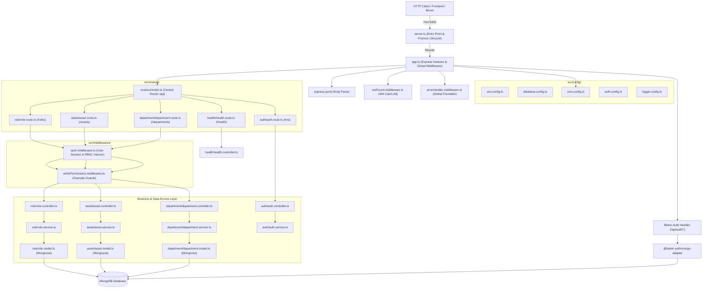

# HRMS Server (Human Resource Management System)

[](https://nodejs.org/)
[](https://www.typescriptlang.org/)
[](https://expressjs.com/)
[](https://mongoosejs.com/)
[](https://www.better-auth.com/)
[](#license)

An enterprise-grade, modular backend service for Human Resource Management Systems (HRMS), engineered with Node.js, Express, TypeScript, Mongoose ODM, and Better-Auth. It delivers robust Role-Based Access Control (RBAC), asset tracking, collision-safe soft deletion with recycle bin recovery, structured audit logging, and a decoupled architecture.

---

## Table of Contents

1. [Architectural Overview](#architectural-overview)
2. [Project Structure](#project-structure)
3. [Core Capabilities & Engineering Patterns](#core-capabilities--engineering-patterns)
4. [Environment Configuration](#environment-configuration)
5. [Getting Started & Installation](#getting-started--installation)
6. [Available Scripts](#available-scripts)
7. [API Route Catalog](#api-route-catalog)
8. [Permission Matrix (RBAC)](#permission-matrix-rbac)
9. [Data Models & Schema Reference](#data-models--schema-reference)
10. [Error Handling & Response Format](#error-handling--response-format)
11. [API Testing with Bruno](#api-testing-with-bruno)
12. [Documentation Links](#documentation-links)

---

## Architectural Overview

The application follows a **Decoupled Modular Architecture** separating process bootstrapping, HTTP application configuration, route aggregation, feature domains, and reusable utilities.



### Key Architectural Separation

- **`server.ts`**: Pure entry point. Boots infrastructure, connects to database with retry loops, listens on the configured port, and manages graceful shutdowns on `SIGINT` / `SIGTERM`.
- **`app.ts`**: Express application factory. Configures global middlewares in precise order (CORS, unparsed body handler for Better Auth, JSON body parser), mounts the central router, and registers error handlers.
- **`routecontroller.ts`**: Central router index. Mounts domain routers with unified `/api` versioning and routing hierarchy.
- **`src/module/<feature>/`**: Self-contained domain modules containing their own route, controller, service, model, and interface.
- **Thin Controllers & Focused Services**: Controllers extract input, call domain services, and format HTTP responses. Services contain database queries and business logic.

---

## Project Structure

```text
src/
├── app.ts                               # Express application configuration & middleware pipeline
├── server.ts                            # Entry point, database boot & graceful shutdown
├── routecontroller.ts                   # Central route aggregator (/api)
├── index.ts                             # Package re-export entry
│
├── config/                              # Infrastructure and application configurations
│   ├── env.config.ts                    # Typed environment variable loader & validator
│   ├── database.config.ts               # MongoDB Mongoose connection with exponential retries
│   ├── cors.config.ts                   # Dynamic CORS origin validator & credential options
│   ├── auth.config.ts                   # Better-Auth initialization & native MongoDB adapter
│   ├── logger.config.ts                 # Logger configuration & thresholds
│   └── index.ts                         # Central configuration barrel export
│
├── constants/                           # System-wide static definitions
│   └── permissions.constant.ts          # 23 canonical RBAC permissions & TypeScript types
│
├── middlewares/                         # Shared Express middlewares
│   ├── auth.middleware.ts               # User identity & mock permission injector (verifyUser)
│   ├── verifyPermissions.middleware.ts  # Granular RBAC permission check guard
│   ├── errorHandler.middleware.ts       # Global error handling & stack logging
│   ├── notFound.middleware.ts           # 404 handler for unmapped routes
│   └── index.ts                         # Central middleware barrel export
│
├── module/                              # Feature-based modular business domains
│   ├── role/                            # Role & RBAC Management Module
│   │   ├── role.controller.ts           # HTTP handlers for roles
│   │   ├── role.service.ts              # Database operations & business rules for roles
│   │   ├── role.route.ts                # Route definitions & permission bindings
│   │   ├── role.model.ts                # Mongoose schema, partial unique index & soft-delete hook
│   │   ├── role.interface.ts            # TypeScript interfaces for Role entity
│   │   └── role.constant.ts             # Role-specific constants
│   │
│   ├── asset/                           # Asset Inventory Module
│   │   ├── asset.controller.ts          # HTTP handlers for assets
│   │   ├── asset.service.ts             # Database operations & business rules for assets
│   │   ├── asset.route.ts               # Route definitions & permission bindings
│   │   ├── asset.model.ts               # Mongoose schema, partial index & soft-delete hook
│   │   └── asset.interface.ts           # TypeScript interfaces for Asset entity
│   │
│   ├── department/                      # Department Management Module
│   │   ├── department.controller.ts     # HTTP handlers for departments
│   │   ├── department.service.ts        # Database operations & business rules for departments
│   │   ├── department.route.ts          # Route definitions & permission bindings
│   │   ├── department.model.ts          # Mongoose schema, partial index & soft-delete hook
│   │   └── department.interface.ts      # TypeScript interfaces for Department entity
│   │
│   ├── assetAssign/                     # Asset Assignment Module (Foundation)
│   │   ├── assetAssign.controller.ts    # Assignment handlers
│   │   ├── assetAssign.service.ts       # Assignment data services
│   │   ├── assetAssign.route.ts         # Assignment routes
│   │   ├── assetAssign.model.ts         # Asset assignment schema
│   │   └── assetAssign.interface.ts     # Assignment interfaces
│   │
│   ├── auth/                            # Authentication & Session Module
│   │   ├── auth.controller.ts           # Better-Auth handler & /api/me handler
│   │   ├── auth.service.ts              # Session verification services
│   │   ├── auth.route.ts                # Auth route mappings
│   │   └── auth.interface.ts            # Session & user types
│   │
│   └── health/                          # System Health & Diagnostic Module
│       ├── health.controller.ts         # Service status & heartbeat handler
│       └── health.route.ts              # Route binding for /health
│
├── types/                               # TypeScript ambient declarations
│   └── express.d.ts                     # Declaration merging for Express.Request (userId, permissions)
│
└── utility/                             # Reusable helper utilities
    ├── catchAsync.ts                    # Asynchronous route wrapper
    ├── sendResponse.ts                  # Standard API response utility
    ├── ApiError.ts                      # Custom operational error class
    ├── logger.ts                        # Multi-level structured logger (development & production)
    └── index.ts                         # Central utility barrel export
```

---

## Core Capabilities & Engineering Patterns

### 1. Collision-Free Soft Deletion & Recycle Bin
- Every primary model contains `isDeleted: boolean`, `deletedAt: Date`, and `deletedBy: ObjectId`.
- **Pre-Find Filter Hook**: A Mongoose pre-hook automatically injects `{ isDeleted: false }` into every find operation unless explicitly bypassed (`{ includeDeleted: true }`).
- **Recycle Bin**: Accessible via dedicated `/recycle_bin` endpoints which selectively fetch items with `{ isDeleted: true }`.
- **Single-Click Restore**: Restoration endpoints reset `isDeleted` to `false`, clear timestamps, and record the restoring actor.

### 2. Partial Unique Indexes
- Standard unique indexes in MongoDB reject re-creating an entity with the same unique attribute (such as `name` or `serialNumber`) even if previous instances were deleted.
- This system uses **MongoDB Partial Filter Expressions**:
  ```typescript
  roleSchema.index(
    { name: 1 },
    { unique: true, partialFilterExpression: { isDeleted: false } }
  );
  ```
- This ensures uniqueness among active documents while allowing names and serial numbers of soft-deleted items to be reused immediately.

### 3. Granular RBAC Permissions
- System permissions are compiled into a strongly-typed constant list in [`permissions.constant.ts`](file:///home/msi-rafi/projects/european/HRMS-Server/src/constants/permissions.constant.ts).
- The Mongoose `Role` schema generates its sub-schema dynamically by reducing this array into typed booleans.
- Endpoints use the `verifyPermissions([...requiredKeys])` middleware guard to ensure requesting users have every required capability before delegating to the controller.

### 4. Better-Auth Integration
- Leverages [Better-Auth](https://www.better-auth.com/) backed by native MongoDB client connection pooling.
- Mounted at `/api/auth/*` before Express JSON body parser to ensure raw request streaming for auth payloads.
- Verified `/api/me` endpoint to inspect authenticated session states.

### 5. Multi-Mode Structured Logger
- Detects `NODE_ENV`. In `production`, outputs structured JSON logs suitable for Datadog, CloudWatch, or ELK.
- In `development`, formats with colored tags (`[INFO]`, `[WARN]`, `[ERROR]`), user identification context, and indented metadata.

---

## Environment Configuration

Configuration variables are managed through `.env`. Copy `.env.example` to start:

```bash
cp .env.example .env
```

| Variable | Type | Default | Description |
|---|---|---|---|
| `PORT` | Number | `5000` | HTTP port on which the Express server listens. |
| `NODE_ENV` | String | `development` | Environment mode (`development` \| `production`). |
| `PRODUCTION` | Boolean | `false` | Production toggle flag. |
| `ALLOW_ORIGIN` | String | `http://localhost:3000,http://localhost:5000` | Comma-delimited list of permitted CORS origins. |
| `MONGO_URI` | String | `mongodb://127.0.0.1:27017/hrms` | MongoDB connection URI. |
| `BETTER_AUTH_SECRET` | String | *Required in Prod* | Encryption secret for Better-Auth tokens (minimum 32 chars). |
| `BETTER_AUTH_URL` | String | `http://localhost:5000` | Base URL used by Better-Auth for callback routing. |
| `LOG_LEVEL` | String | `info` | Threshold for logging (`debug`, `info`, `warn`, `error`). |

---

## Getting Started & Installation

### Prerequisites
- [Node.js](https://nodejs.org/) `>= 18.19.0`
- [MongoDB](https://www.mongodb.com/) `>= 6.0` (Local service or MongoDB Atlas)
- [pnpm](https://pnpm.io/) or [npm](https://www.npmjs.com/)

### Step 1: Clone and Install
```bash
git clone <repository-url>
cd HRMS-Server
npm install
# or
pnpm install
```

### Step 2: Configure Environment
Edit `.env` to match your local MongoDB connection:
```env
PORT=5000
NODE_ENV=development
ALLOW_ORIGIN=http://localhost:3000,http://localhost:5000
MONGO_URI=mongodb://127.0.0.1:27017/hrms
BETTER_AUTH_SECRET=fedcba0987654321fedcba0987654321
BETTER_AUTH_URL=http://localhost:5000
LOG_LEVEL=info
```

### Step 3: Run Development Server
```bash
npm run dev
# or
pnpm dev
```
The server will start with hot-reloading powered by `tsx watch`:
```text
Server is starting / reloading...
Environment: development
Log Level: info
Allowed Origins: http://localhost:3000,http://localhost:5000
MongoDB Connected: 127.0.0.1:27017
Server running on port 5000
Health Check: http://localhost:5000/api/health
```

---

## Available Scripts

| Command | Action |
|---|---|
| `npm run dev` | Starts server in watch mode using `tsx watch src/server.ts`. |
| `npm run start` | Starts server using Node.js runtime. |
| `npx tsc --noEmit` | Executes TypeScript type checking across all modules. |

---

## API Route Catalog

All routes are mounted under the `/api` prefix.

### 1. Diagnostics & Session

| Method | Endpoint | Auth | Required Permissions | Description |
|---|---|---|---|---|
| `GET` | `/api/health` | Public | None | Server heartbeat & status check. |
| `GET` | `/api/me` | Session | Valid Auth Session | Returns currently authenticated user session. |

### 2. Better-Auth System (`/api/auth/*`)

| Method | Endpoint | Description |
|---|---|---|
| `POST` | `/api/auth/sign-up/email` | Create new user account with email and password. |
| `POST` | `/api/auth/sign-in/email` | Authenticate existing user with credentials. |
| `POST` | `/api/auth/sign-out` | Destroy session and clear session cookies. |
| `GET` | `/api/auth/get-session` | Fetch active session payload. |

### 3. Role Management (`/api/roles`)

| Method | Endpoint | Auth | Required Permissions | Description |
|---|---|---|---|---|
| `GET` | `/api/roles` | Required | `readRoleList` | List active roles with pagination (`?page=1&limit=10`). |
| `GET` | `/api/roles/recycle_bin` | Required | `readRole` | List soft-deleted roles with pagination. |
| `GET` | `/api/roles/:id` | Required | `readRole` | Retrieve specific role by ObjectId. |
| `POST` | `/api/roles` | Required | `createRole` | Create a new role with specific permissions. |
| `PUT` | `/api/roles/:id` | Required | `updateRole` | Update role metadata or permission map. |
| `DELETE` | `/api/roles/:id` | Required | `deleteRole` | Soft-delete a role (moves to recycle bin). |
| `PATCH` | `/api/roles/:id/restore`| Required | `restoreRole` | Restore a deleted role back to active status. |

### 4. Asset Management (`/api/assets`)

| Method | Endpoint | Auth | Required Permissions | Description |
|---|---|---|---|---|
| `GET` | `/api/assets` | Required | `readAssetList` | List active assets with pagination (`?page=1&limit=10`). |
| `GET` | `/api/assets/recycle_bin` | Required | `readAsset` | List soft-deleted assets in recycle bin. |
| `GET` | `/api/assets/:id` | Required | `readAsset` | Retrieve specific asset by ObjectId. |
| `POST` | `/api/assets` | Required | `createAsset` | Create a new inventory asset. |
| `PUT` | `/api/assets/:id` | Required | `updateAsset` | Update asset details or status. |
| `DELETE` | `/api/assets/:id` | Required | `deleteAsset` | Soft-delete an asset. |
| `PATCH` | `/api/assets/:id/restore`| Required | `restoreAsset` | Restore a deleted asset back to inventory. |

### 5. Department Management (`/api/departments`)

| Method | Endpoint | Auth | Required Permissions | Description |
|---|---|---|---|---|
| `GET` | `/api/departments` | Required | `readDepartmentList` | List active departments with pagination (`?page=1&limit=10`). |
| `GET` | `/api/departments/recycle_bin` | Required | `readDepartment` | List soft-deleted departments in recycle bin. |
| `GET` | `/api/departments/:id` | Required | `readDepartment` | Retrieve specific department by ObjectId. |
| `POST` | `/api/departments` | Required | `createDepartment` | Create a new department. |
| `PUT` | `/api/departments/:id` | Required | `updateDepartment` | Update department details or status. |
| `DELETE` | `/api/departments/:id` | Required | `deleteDepartment` | Soft-delete a department. |
| `PATCH` | `/api/departments/:id/restore`| Required | `restoreDepartment` | Restore a deleted department back to active status. |

---

## Permission Matrix (RBAC)

The system defines 24 permissions across 4 functional domains in `src/constants/permissions.constant.ts`:

| Domain | Permission Key | Description |
|---|---|---|
| **Employee** | `readEmployeeList` | View paginated employee directory |
| | `readEmployee` | View individual employee profile |
| | `createEmployee` | Register a new employee |
| | `updateEmployee` | Modify employee profile details |
| | `deleteEmployee` | Soft delete an employee |
| **Role** | `readRoleList` | View all system roles |
| | `readRole` | View role details or recycle bin |
| | `createRole` | Create a new RBAC role |
| | `updateRole` | Modify role permissions or description |
| | `deleteRole` | Soft delete a role |
| | `restoreRole` | Restore a deleted role from recycle bin |
| **Department** | `readDepartmentList` | View department listing |
| | `readDepartment` | View single department details |
| | `createDepartment` | Create a new department |
| | `updateDepartment` | Update department details |
| | `deleteDepartment` | Soft delete a department |
| | `restoreDepartment` | Restore a deleted department |
| **Assets** | `readAssetList` | View asset inventory |
| | `readAsset` | View single asset details or recycle bin |
| | `createAsset` | Register a new asset |
| | `updateAsset` | Modify asset specifications |
| | `deleteAsset` | Soft delete an asset |
| | `restoreAsset` | Restore a deleted asset |
| | `assignAsset` | Assign asset to an employee |

---

## Data Models & Schema Reference

### Role Schema
```typescript
{
  name: { type: String, required: true, trim: true },
  description: { type: String, default: '', trim: true },
  status: { type: String, enum: ['active', 'inactive', 'disabled'], default: 'active', index: true },
  permissions: {
    readEmployeeList: { type: Boolean, default: false },
    // ... all 23 permissions auto-generated
  },
  createdBy: { type: Schema.Types.ObjectId, ref: 'User', required: true },
  updatedBy: { type: Schema.Types.ObjectId, ref: 'User' },
  isDeleted: { type: Boolean, default: false, index: true },
  deletedAt: { type: Date, default: null },
  deletedBy: { type: Schema.Types.ObjectId, ref: 'User', default: null },
  timestamps: true
}
```
- **Indexes**: `{ name: 1 }` unique partial index where `isDeleted: false`.

### Asset Schema
```typescript
{
  assetName: { type: String, required: true, trim: true, index: true },
  description: { type: String, default: '', trim: true },
  serialNumber: { type: String, trim: true },
  status: { type: String, enum: ['active', 'inactive', 'disabled'], default: 'active', index: true },
  qty: { type: Number, default: 0, min: 0 },
  createdBy: { type: Schema.Types.ObjectId, ref: 'User', required: true },
  updatedBy: { type: Schema.Types.ObjectId, ref: 'User' },
  isDeleted: { type: Boolean, default: false, index: true },
  deletedAt: { type: Date, default: null },
  deletedBy: { type: Schema.Types.ObjectId, ref: 'User', default: null },
  timestamps: true
}
```
- **Indexes**: `{ serialNumber: 1 }` unique partial index where `serialNumber` exists and `isDeleted: false`.

### Department Schema
```typescript
{
  name: { type: String, required: true, trim: true },
  description: { type: String, default: '', trim: true },
  status: { type: String, enum: ['active', 'inactive', 'disabled'], default: 'active', index: true },
  createdBy: { type: Schema.Types.ObjectId, ref: 'User', required: true },
  updatedBy: { type: Schema.Types.ObjectId, ref: 'User' },
  isDeleted: { type: Boolean, default: false, index: true },
  deletedAt: { type: Date, default: null },
  deletedBy: { type: Schema.Types.ObjectId, ref: 'User', default: null },
  timestamps: true
}
```
- **Indexes**: `{ name: 1 }` unique partial index where `isDeleted: false`.

### AssetAssign Schema
```typescript
{
  asset: { type: Schema.Types.ObjectId, ref: 'Asset', required: true, index: true },
  user: { type: Schema.Types.ObjectId, ref: 'User', required: true, index: true },
  itemQty: { type: Number, required: true, min: 1 },
  status: { type: String, enum: ['active', 'inactive', 'disabled', 'assigned', 'returned'], default: 'assigned', index: true },
  createdBy: { type: Schema.Types.ObjectId, ref: 'User', required: true },
  updatedBy: { type: Schema.Types.ObjectId, ref: 'User' },
  isDeleted: { type: Boolean, default: false, index: true },
  deletedAt: { type: Date, default: null },
  deletedBy: { type: Schema.Types.ObjectId, ref: 'User', default: null },
  timestamps: true
}
```

---

## Error Handling & Response Format

All responses follow a consistent, predictable format.

### Success Response Format
```json
{
  "success": true,
  "message": "Role created successfully",
  "data": {
    "_id": "6724a8bfb972e0081d4289a1",
    "name": "HR Manager",
    "status": "active"
  }
}
```

### Error Response Format
```json
{
  "success": false,
  "status": 403,
  "message": "Insufficient permissions"
}
```

### HTTP Status Code Standards
- `200 OK`: Request succeeded.
- `201 Created`: Resource successfully created.
- `400 Bad Request`: Input validation failed or malformed identifier.
- `401 Unauthorized`: Session token is absent, expired, or invalid.
- `403 Forbidden`: Authenticated actor lacks required permission in `req.permissions`.
- `404 Not Found`: Target resource or route path does not exist.
- `500 Internal Server Error`: Server exception handled and logged by `errorHandler`.

---

## API Testing with Bruno

Pre-configured [Bruno](https://www.usebruno.com/) API collection files are maintained in the repository under `API_TEST/HRMS/`:

- **Role Management (`API_TEST/HRMS/Role/`)**:
  - `AllRole.yml`: `GET /api/roles`
  - `Role By ID.yml`: `GET /api/roles/:id`
  - `Role recycle bin.yml`: `GET /api/roles/recycle_bin`
  - `Create Role.yml`: `POST /api/roles`
  - `Update Role.yml`: `PUT /api/roles/:id`
  - `Delete Role.yml`: `DELETE /api/roles/:id`
  - `Restore Role.yml`: `PATCH /api/roles/:id/restore`
- **Asset Management (`API_TEST/HRMS/Assert/`)**:
  - `AllAssert.yml`: `GET /api/assets`
  - `Assert By ID.yml`: `GET /api/assets/:id`
  - `Assert recycle bin.yml`: `GET /api/assets/recycle_bin`
  - `Create Assert.yml`: `POST /api/assets`
  - `Update Assert.yml`: `PUT /api/assets/:id`
  - `Delete Assert.yml`: `DELETE /api/assets/:id`
  - `Restore Assert.yml`: `PATCH /api/assets/:id/restore`
- **Department Management (`API_TEST/HRMS/Department/`)**:
  - `AllDepartment.yml`: `GET /api/departments`
  - `Department By ID.yml`: `GET /api/departments/:id`
  - `Department recycle bin.yml`: `GET /api/departments/recycle_bin`
  - `Create Department.yml`: `POST /api/departments`
  - `Update Department.yml`: `PUT /api/departments/:id`
  - `Delete Department.yml`: `DELETE /api/departments/:id`
  - `Restore Department.yml`: `PATCH /api/departments/:id/restore`

To run tests in Bruno:
1. Open Bruno and select **Open Collection**.
2. Point Bruno to the `API_TEST/HRMS` folder.
3. Select an environment or configure base URL to `http://localhost:5000`.

---

## Documentation Links

- **Technical API Reference**: [`API_DOCUMENTATION.md`](./API_DOCUMENTATION.md) — Comprehensive technical reference with full request/response payload examples.
- **Interactive Documentation**: [`docs/index.html`](./docs/index.html) — Standalone interactive API portal.

---

## License

This project is licensed under the **ISC License**.